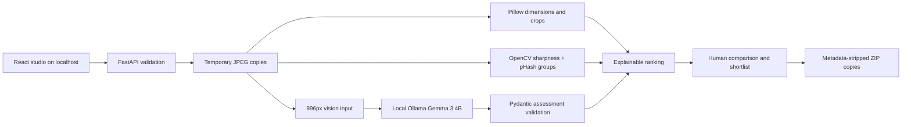

# Architecture

## Scoring

Gemma assigns ordinal relevance and suitability, each 0–4 (none/weak/partial/good/strong), not a calibrated probability. Score = 100 × (0.60 × relevance/4 + 0.25 × suitability/4 + 0.10 × crop area retained + 0.05 × min(1, pixels/2 million)) minus 5 points when a previous successfully assessed upload belongs to the same duplicate group. Rounded score is a fit index. Weights live in `rank`; changing them requires validation. Duplicate penalties depend on upload order and are a simple diversity heuristic, not a learned aesthetic judgment. All frames remain available. Gemma supplies semantic assessment directly; no separate embedding baseline is represented as implemented.

Sharpness is Laplacian variance on a resized grayscale copy; it is returned as descriptive metadata and never enters ranking. Intentional blur is not automatically penalized. Crops are centered geometric cuts with retained area warnings, not subject detection. Carousel/profile use square framing without sequence optimization or circular mask preview.

Cache keys include uploaded-byte digest, exact brief, mode, format and configured model tag. They are memory-only; changing model weights under the same tag requires restarting. All candidates are assessed once per cache key; no OpenCLIP preselection. One asyncio lock serializes jobs to bound GPU pressure. A single process is required; do not start multiple Uvicorn workers.

## API

OpenAPI: `/docs`. JSON bodies validated by Pydantic.

| Method | Path | Purpose |
|---|---|---|
| GET | /api/health | Batch and file limits |
| GET | /api/models/status | Ollama installed model check |
| POST | /api/collections | Create random collection ID |
| POST | /api/collections/{id}/photos | Multipart `files` upload, transactional per request |
| GET | /api/collections/{id}/photos | Photo metadata |
| GET | /api/collections/{id}/photos/{photo_id} | Processing preview, no-store |
| DELETE | /api/collections/{id}/photos/{photo_id} | Remove processing photo |
| POST | /api/analyze | `{collection_id, brief, mode, format, count}` → job ID |
| GET | /api/analysis/{id} | Status, progress, validated results/errors |
| POST | /api/export | `{collection_id, photo_ids, format}` → ordered ZIP |
| DELETE | /api/collections/{id} | Delete temporary data and job metadata |

No `/shortlist` endpoint: selection/order live in React and are submitted explicitly to export. Format enum: story, square, portrait, carousel, profile, original. Jobs are in-process background tasks and survive neither server restart nor collection deletion. Partial failures preserve successful assessments; no fallback recommendations are produced. Model JSON validation failures and HTTP errors are visible per photo. A stale/missing collection yields a failed job. HTTP 404 unknown ID; 409 running job conflict; 413 byte limit; 415 unsupported/invalid image; 422 request or batch validation.
